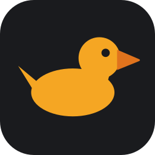
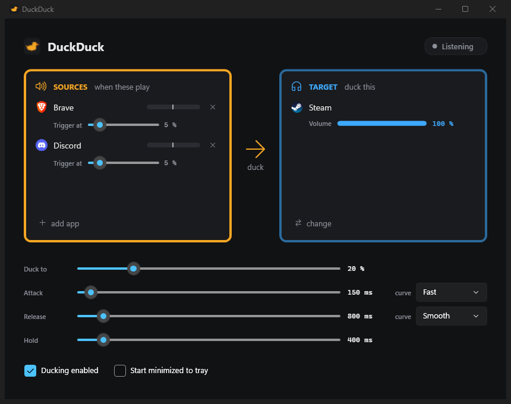
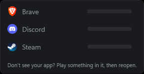
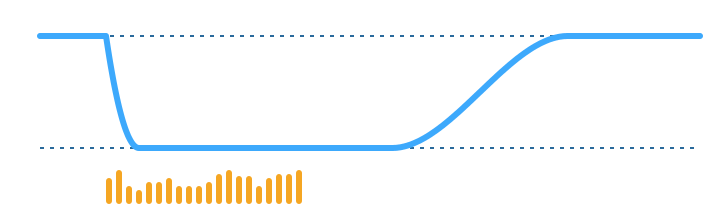

<p align="center">
  
</p>

<h1 align="center">DuckDuck</h1>

<p align="center"><strong>Talk over the music.</strong><br>
Lowers one Windows app when another one makes sound, then brings it back.</p>

<p align="center">
  <a href="https://github.com/zebadrabbit/DuckDuck/releases/latest">Download</a> ·
  <a href="#how-it-works">How it works</a> ·
  <a href="#settings">Settings</a> ·
  <a href="#build-from-source">Build</a>
</p>



Pick **sources** (Discord, your browser) and one **target** (Spotify). When any source
plays audio, the target's volume drops to the level you set. When the sources go quiet,
it fades back up. Attack, hold and release times and curves shape the ramp.

It drives the per-app slider in the Windows Volume Mixer, so nothing is hidden and
nothing inside the target app is touched.

## Install

1. Download `DuckDuck.exe` from the [latest release](https://github.com/zebadrabbit/DuckDuck/releases/latest).
2. Run it. There is no installer and nothing else to install.

Windows 10 or 11, 64-bit. The exe is self-contained (it carries its own .NET runtime,
which is why it's large).

SmartScreen may warn the first time because the exe isn't code-signed. Click
**More info → Run anyway**, or build it yourself from source.

## Use

- **add app** under SOURCES lists every app that currently has an audio session. Pick
  the ones that should trigger ducking. Each source gets its own **Trigger at** slider
  and a tick on its level meter, so you can watch the peak cross it.
- **Microphone** in the same list is whichever mic an app is recording from right now, so
  you can duck when *you* talk. It is live during a call and shown idle otherwise: DuckDuck
  never opens a mic itself, because that would switch a Bluetooth headset into its
  low-quality hands-free profile. It is the raw level before Discord's noise gate, so raise
  its **Trigger at** until keyboard noise stays under the tick.
- **pick app** under TARGET chooses the app to duck.
- Don't see your app? Play something in it, then reopen the picker. Windows only
  creates an audio session once an app has made sound.
- Closing the window keeps DuckDuck running in the tray. Left-click the tray icon to
  bring it back. Right-click for **Enabled**, **Show** and **Exit**.



## How it works



Every 20 ms the engine reads the peak level of what each source process is rendering
(Windows process loopback, so Discord's own tap on the output mix does not count other
apps' audio as Discord). If any source is above its threshold, the target is **active**:

```
Idle ──active──▶ Attack ──done──▶ Ducked ──quiet for Hold ms──▶ Release ──done──▶ Idle
                   ▲                                               │
                   └─────────────── active again ──────────────────┘
```

- **Attack** ramps the target from its current volume down to *Duck to* over the attack
  time, using the attack curve. It always finishes, even if the source stops early.
- **Hold** is how long the sources must stay quiet before the release starts. It stops
  the volume pumping between words.
- **Release** ramps back up to the rest volume. A source going active again mid-release
  restarts the attack from wherever the volume is, with no jump.
- The **rest volume** is whatever the target's mixer slider was before ducking. Change
  it in the Windows mixer while idle and DuckDuck follows.
- Ducking never raises volume. If the target is already below *Duck to*, nothing moves.

If DuckDuck is closed or killed mid-duck, the target is restored on exit, or on the next
launch if it had no chance to.

## Settings

| Setting | Default | What it does |
|---|---|---|
| Duck to | 20 % | Mixer level the target is held at while ducked |
| Attack | 150 ms, Fast | Ramp down time and curve |
| Release | 800 ms, Smooth | Ramp up time and curve |
| Hold | 400 ms | Quiet time required before release |
| Trigger at (per source) | 5 % | Peak level a source must reach to count as playing, measured after its own Windows mixer slider: an app turned down to 30 % in the mixer needs a lower trigger |
| Ducking enabled | on | Off lets a duck in progress release, then never triggers |
| Start minimized to tray | off | |
| Run at Windows startup | off | Adds a Run entry for the current user; starts in the tray |

Curves, as easing of the ramp's progress:

| Curve | Feel |
|---|---|
| Linear | constant rate |
| Fast | moves quickly, then settles |
| Slow | eases in, then moves |
| Smooth | S-curve, gentle at both ends |

Settings are saved as they change to `%APPDATA%\DuckDuck\config.json`.

## Build from source

Needs the [.NET 10 SDK](https://dotnet.microsoft.com/download) on Windows.

```
git clone https://github.com/zebadrabbit/DuckDuck
cd DuckDuck
dotnet build
```

`publish.cmd` produces the single self-contained exe in `dist\`. Two flags help when
something isn't working:

```
DuckDuck.exe --list       # print the audio apps the engine sees, with peaks and volumes, for 5 s
DuckDuck.exe --selftest   # check process-loopback activation and the ducking state machine
```

The app is C# and WPF on .NET 10 with one dependency, [NAudio](https://github.com/naudio/NAudio),
for the Windows Core Audio session API. `SPEC.md` and `PLAN.md` are the design and build
notes it was written from.

## Troubleshooting

- **The target ducks while only the target is playing.** Something else is ducking too.
  Discord's *Voice & Video → Attenuation* lowers other apps when people talk, and the
  *Communications* tab of the classic Windows Sound panel does the same when a call
  starts. Turn both off and let DuckDuck do it alone.
- **A source's meter is dimmed.** Hover it for the reason. For an app, process loopback
  is unavailable (Windows before 10 2004), so its level is the plain session meter, which
  also includes other apps' audio when the source records the output mix. For Microphone,
  no app is recording from any mic right now; join a call and it comes alive.
  `DuckDuck.exe --list` marks such sources with `*`.
- **Nothing ducks.** Check **Ducking enabled** in the window or the tray menu, and that
  the source's meter actually crosses its tick while it plays.

## Limitations

- Apps using exclusive-mode audio bypass the per-app mixer, so they can't be ducked.
- Elevated (run-as-administrator) apps show a generic icon.
- One set of sources and one target. No profiles or hotkeys.

## License

[MIT](LICENSE)
